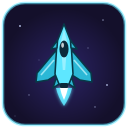
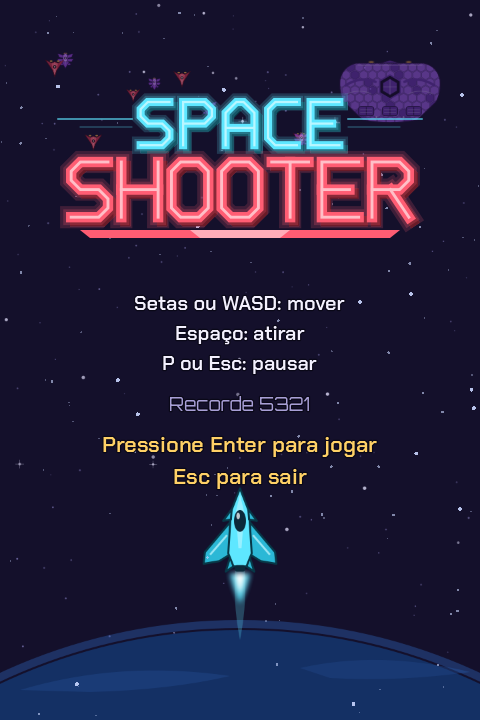
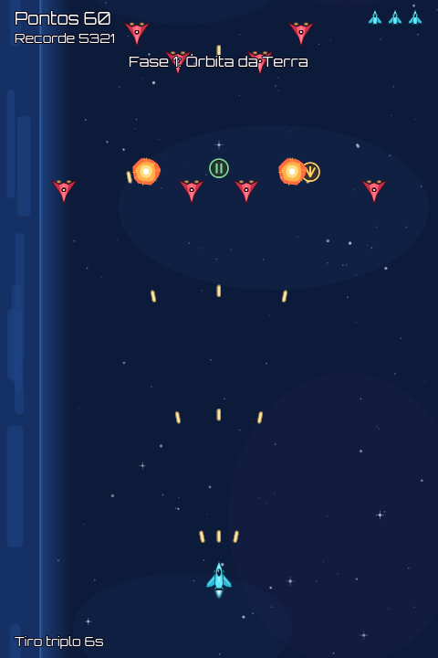
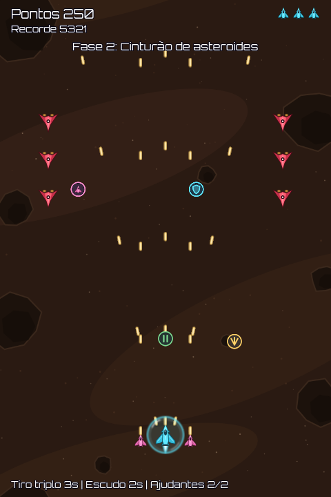
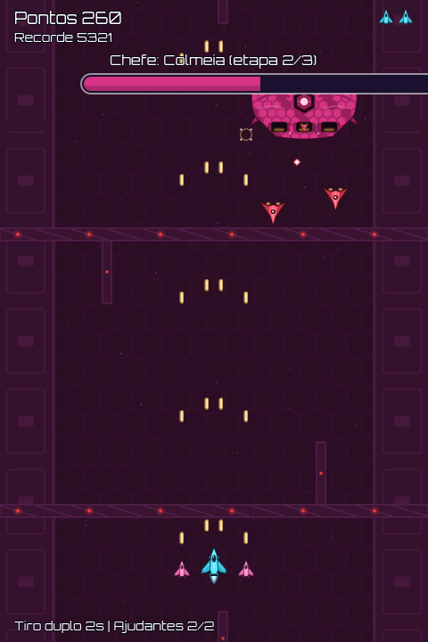
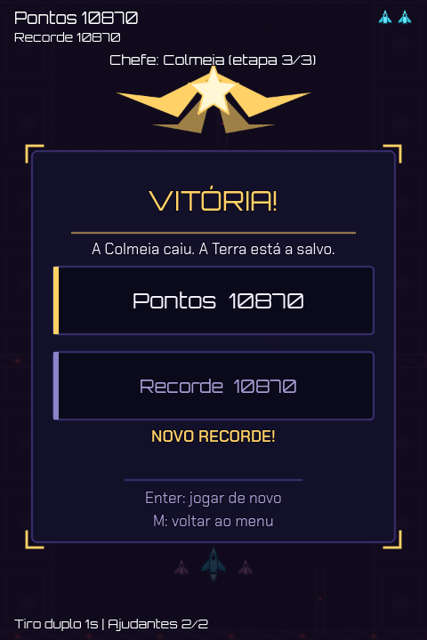
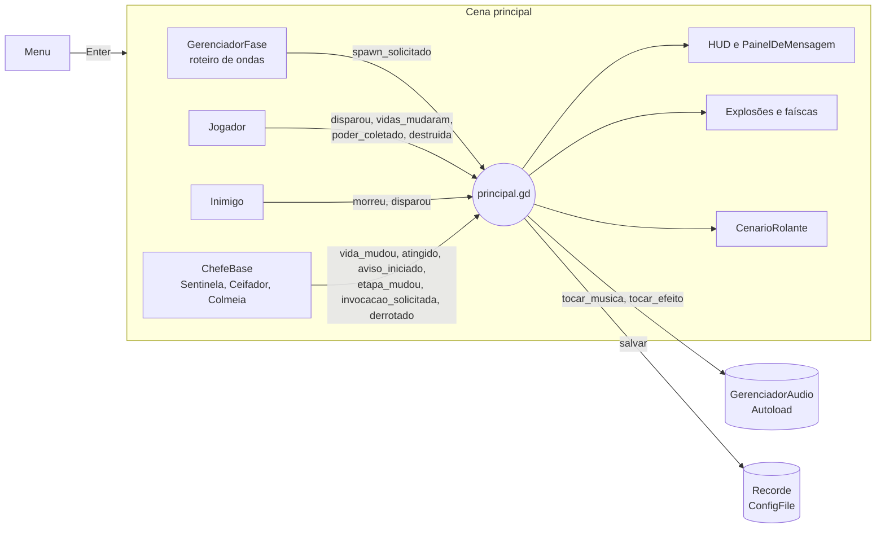
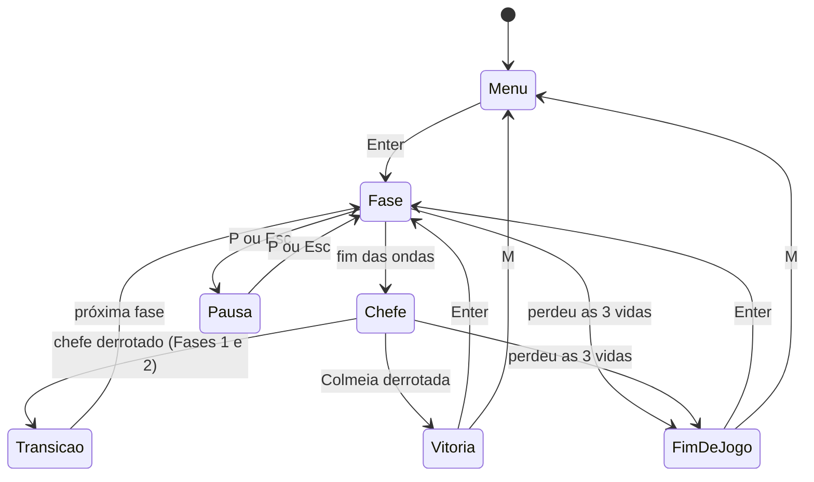

<p align="center">
  
</p>

<h1 align="center">Space Shooter</h1>

<p align="center">
  Arcade clássico de naves, com ondas roteirizadas e chefes de múltiplas etapas.<br>
  Feito na <b>Godot 4.7.2</b> · PC (Windows) · Partida completa de cerca de 9 minutos
</p>

<p align="center">
  
  
  
  
  
</p>

Projeto da disciplina **Fundamentos de Jogos (CMP1199)**, Análise e Desenvolvimento de Sistemas, PUC Goiás, 2026.

## Sumário

1. [Sobre o jogo](#sobre-o-jogo)
2. [Como jogar](#como-jogar)
3. [Fases, inimigos, chefes e poderes](#fases-inimigos-chefes-e-poderes)
4. [Como abrir, rodar e exportar](#como-abrir-rodar-e-exportar)
5. [Arquitetura](#arquitetura)
6. [Estrutura de pastas](#estrutura-de-pastas)
7. [Como modificar o jogo](#como-modificar-o-jogo)
8. [Áudio e arte](#áudio-e-arte)
9. [Como o projeto foi desenvolvido](#como-o-projeto-foi-desenvolvido)
10. [Equipe, créditos e licenças](#equipe-créditos-e-licenças)

---

## Sobre o jogo

Uma frota de drones invasores destruiu toda a defesa orbital da Terra. Resta apenas uma nave de patrulha. O jogador pilota essa nave por **três fases** (a órbita da Terra, o cinturão de asteroides e a Nave-Mãe) até destruir a **Colmeia**, a Nave-Mãe inimiga, antes que ela chegue ao planeta.

| | |
|---|---|
| **Gênero** | Tiro de naves com rolagem vertical (*shoot 'em up*), no estilo de 1942, Galaga e Raiden |
| **Público** | Jogadores casuais que gostam de arcade e de partidas curtas |
| **Classificação** | Livre (violência fantasiosa: só drones e máquinas, sem sangue) |
| **Plataforma** | PC, com teclado |
| **Duração** | Cerca de 9 minutos do menu à vitória |
| **Vitória** | Destruir a Colmeia, chefe da Fase 3 |
| **Derrota** | Perder as 3 vidas |

As fases seguem o princípio **introduzir → combinar → testar**: cada uma apresenta algo novo, mistura com o que veio antes e termina com um chefe que cobra o que o jogador aprendeu.

---

## Como jogar

### Controles

| Ação | Teclas |
|---|---|
| Mover a nave | Setas ou W A S D |
| Atirar | Espaço (segure para atirar sem parar) |
| Pausar e continuar | P ou Esc |
| Voltar ao menu (com o jogo pausado) | M |
| Começar a jogar (no menu) | Enter ou Espaço |
| Sair do jogo (no menu) | Esc |
| Jogar de novo (nas telas de fim e de vitória) | Enter ou Espaço |
| Voltar ao menu (nas telas de fim e de vitória) | M |

A nave se move livremente pela metade de baixo da tela e dispara um tiro a cada 0,2 s.

### Tela durante a partida

| Onde | O que mostra |
|---|---|
| Canto superior esquerdo | Pontos e recorde |
| Canto superior direito | Vidas (um ícone de nave por vida) |
| Centro, no alto | Nome da fase ou do chefe, com a etapa atual |
| Abaixo do nome | Barra de vida do chefe, na cor dele |
| Rodapé | Poderes ativos e o tempo que falta |

### Dicas

- Depois de levar dano, a nave pisca e fica invencível por 1,5 s.
- Os chefes **piscam em branco e tocam um alarme** antes de um ataque forte. Esse é o momento de sair da frente.
- Levar dano tira **todos** os poderes ativos. Vale a pena arriscar para pegar um poder, mas com cuidado.
- O recorde é salvo no computador e aparece no menu.

---

## Fases, inimigos, chefes e poderes

### Fases

| | Fase 1: Órbita da Terra | Fase 2: Cinturão de asteroides | Fase 3: Nave-Mãe |
|---|---|---|---|
| **Cores** | Azul | Laranja e marrom | Roxo e vermelho |
| **História** | O último caça decola | A frota se esconde entre as rochas | A Nave-Mãe se aproxima da Terra |
| **Inimigos** | Batedor | Batedor e Serpente | Batedor, Serpente e Bastião |
| **O que ensina** | Mover, atirar e desviar | Formações e movimento lateral | Tiros inimigos e escolha de qual alvo derrubar primeiro |
| **Perigo extra** | Nenhum | Asteroides em 3 tamanhos | Chuva de projéteis |
| **Poderes** | Tiro duplo e tiro triplo | Escudo e nave de ajuda | Todos |
| **Chefe** | Sentinela-01 | Ceifador | Colmeia |
| **Duração** | Cerca de 2:45 | Cerca de 3:00 | Cerca de 3:30 |

Cada fase é um **roteiro de ondas**: em um momento definido entra uma formação (linha, V ou flancos), com pausas de respiro entre os blocos. Quando a última onda passa e a tela fica vazia, entra o chefe.

### Inimigos

| Inimigo | Comportamento | Vida | Pontos |
|---|---|---|---|
| Batedor | Drone rápido que desce em linha reta | 1 | 10 |
| Serpente | Desce oscilando de um lado para o outro | 1 | 20 |
| Bastião | Blindado e lento, atira para baixo e racha depois do primeiro tiro | 3 | 50 |
| Asteroide pequeno, médio e grande | Desce girando; quanto maior, mais lento e mais resistente | 4, 6 e 9 | 5, 10 e 20 |

### Chefes

Os três chefes usam a mesma base e mudam só o padrão de ataque. Todo ataque forte é avisado antes.

| Chefe | Fase | Vida | Pontos | Ataques |
|---|---|---|---|---|
| Sentinela-01 | 1 | 50 | 300 | Patrulha na horizontal e atira um leque de 5 tiros |
| Ceifador | 2 | 70 | 500 | Rajadas miradas no jogador e investidas até embaixo |
| Colmeia | 3 | 160 | 1000 | Três etapas, que mudam conforme a vida cai (tabela abaixo) |

| Etapa da Colmeia | Vida | Cor | Ataque |
|---|---|---|---|
| 1 | 100% a 66% | Roxa | Leque de 7 tiros |
| 2 | 66% a 33% | Rosa | Chama 3 Batedores e dispara tiros mirados |
| 3 | Abaixo de 33% | Vermelha | Rajadas de 5 tiros e investidas, atirando na volta |

### Poderes

Os poderes caem dos inimigos destruídos (15% de chance) e cada fase libera os seus.

| Poder | Ícone | Efeito | Duração |
|---|---|---|---|
| Tiro duplo | Verde | Dois tiros paralelos | 8 s |
| Tiro triplo | Amarelo | Três tiros em leque | 8 s |
| Escudo | Ciano | Anel que destrói o que encosta; a nave não perde vida | 5 s |
| Nave de ajuda | Rosa | Pequena nave que acompanha o jogador e atira junto (até 2) | Até levar dano |

Regras:

- Só um modo de tiro vale por vez: o último coletado substitui o anterior.
- O escudo e as naves de ajuda funcionam junto com qualquer modo de tiro.
- Pegar o mesmo poder de novo renova o tempo.
- Levar dano zera todos os poderes.
- Com tiro triplo e duas naves de ajuda, saem 5 tiros por disparo.

---

## Como abrir, rodar e exportar

### Requisitos

- [Godot Engine 4.7.2](https://godotengine.org/download) (versão padrão, sem .NET)
- Para gerar os sons ou a arte de novo (opcional): Python 3

### Abrir e jogar pelo editor

1. Clone o repositório:
   ```
   git clone https://github.com/VHAPorfirium/SpaceShooter.git
   ```
2. Abra a Godot, clique em **Importar** e escolha o arquivo `project.godot` da pasta clonada.
3. Na primeira abertura, a Godot importa a arte, os sons e as fontes (leva alguns segundos).
4. Aperte **F5** (ou o botão ▶ no canto superior direito) para jogar a partir do menu.

### Exportar para Windows

1. Instale os modelos de exportação em **Editor → Gerenciar Modelos de Exportação**.
2. Abra **Projeto → Exportar**, adicione a predefinição **Windows Desktop** (se ainda não existir) e clique em **Exportar Projeto**.
3. O ícone do executável (`assets/icone/space_shooter.ico`) já está configurado no projeto.
4. Envie junto com o jogo o aviso de licença da Godot e os créditos (ver [CREDITOS.md](CREDITOS.md)).

### Onde fica o recorde

O recorde é salvo em `user://recorde.cfg`. No Windows, fica em:

```
%APPDATA%\Godot\app_userdata\Space Shooter\recorde.cfg
```

Apagar esse arquivo zera o recorde.

---

## Arquitetura

O jogo é organizado em **cenas** independentes (nave, inimigo, tiro, chefe), **dados em Resource** (fichas `.tres` de inimigos, poderes e efeitos) e **Signals** (avisos como "inimigo destruído" ou "chefe atingido"). A cena principal escuta esses sinais e coordena pontuação, drops, efeitos, áudio e HUD. Assim, um sistema não precisa conhecer o outro.



### Estados da partida



### Decisões de projeto

| Decisão | Por quê |
|---|---|
| Inimigos, poderes, ondas e camadas de cenário como **Resource** | Um inimigo novo é uma ficha nova, sem mexer no código |
| Uma **base comum para os chefes** (`ChefeBase`) com etapas, avisos e ataques reaproveitáveis | Cada chefe só decide quando usar cada ataque |
| **Signals** entre as cenas | Evita que uma cena dependa da outra |
| **Autoload** `GerenciadorAudio` | Um ponto único para música e efeitos |
| Visual com **plano B** (`SpriteComPlanoB`) | Se uma arte faltar, aparece o desenho geométrico e o jogo nunca fica sem visual |
| Colisão por **Area2D** e camadas (Jogador, TirosJogador, Inimigos, TirosInimigos) | A Godot cuida das colisões, sem laços manuais |
| Teclas no **InputMap** | Dá para trocar as teclas sem mexer no código |

### Principais scripts

| Script | Responsabilidade |
|---|---|
| `principal.gd` | Coordena a partida: fases, chefes, pontuação, drops, HUD, transições, vitória e fim |
| `catalogo_fases.gd` | Roteiro das 3 fases: ondas, poderes, cenário, música e chefe |
| `gerenciador_fase.gd` | Toca o roteiro de ondas no tempo certo |
| `formacoes.gd` | Calcula as posições das formações em linha, V e flancos |
| `jogador.gd` | Movimento, tiro, poderes, escudo, naves de ajuda e dano |
| `inimigo.gd` | Comportamento genérico de inimigo a partir da ficha `DadosInimigo` |
| `chefe_fase.gd` | Base dos chefes: entrada, vida, etapas, avisos e ataques |
| `sentinela.gd`, `ceifador.gd`, `colmeia.gd` | Padrão de ataque de cada chefe |
| `gerenciador_audio.gd` | Música por faixa e efeitos com limite de sons simultâneos |
| `painel_de_mensagem.gd` | Telas de abertura, transição, vitória e fim de jogo |
| `cenario_rolante.gd` | Fundo de cada fase em camadas, com rolagem |
| `sprite_com_plano_b.gd` | Mostra a arte no tamanho da colisão ou o desenho geométrico |
| `recorde.gd` | Carrega e salva o recorde |

---

## Estrutura de pastas

```
SpaceShooter/
├── project.godot           Configuração do projeto (teclas, tema, ícone, Autoload)
├── icon.svg                Ícone do jogo
├── assets/
│   ├── arte/               SVGs do jogo (jogador, inimigos, chefes, efeitos, cenários, interface)
│   ├── audio/              Músicas e efeitos sonoros (.wav)
│   ├── fontes/             Orbitron e Chakra Petch (OFL) e o tema do jogo
│   └── icone/              Ícone em .ico (Windows) e .png
├── data/                   Fichas dos inimigos e poderes (.tres)
│   └── efeitos/            Animações de explosão e faísca
├── scenes/                 Cenas do jogo (.tscn)
├── script/                 Código em GDScript
├── tools/
│   ├── gerar_audio.py      Gera todos os sons do jogo
│   └── gerador_arte/       Código que gera todos os SVGs
├── docs/imagens/           Imagens deste README
├── CREDITOS.md             Origem e licença de cada recurso
└── README.md
```

---

## Como modificar o jogo

### Mudar o roteiro de uma fase

As ondas ficam em `script/catalogo_fases.gd`. Cada linha é uma onda:

```gdscript
_onda(16.0, V, BATEDOR, 5, 45.0, CENTRO),
#     |     |  |        |  |     posição horizontal do centro da formação
#     |     |  |        |  espaçamento entre os inimigos (px)
#     |     |  |        quantidade de inimigos
#     |     |  tipo de inimigo (ficha .tres)
#     |     formação: LINHA, V ou FLANCOS
#     momento em que a onda entra (segundos desde o início da fase)
```

Intervalos sem ondas viram pausas de respiro. Mexer nos momentos e nas quantidades é a forma mais rápida de balancear a dificuldade.

### Criar um inimigo novo

1. No editor, clique com o botão direito em `data/` → **Novo Recurso** → `DadosInimigo`.
2. Preencha nome, vida, velocidade, pontos, tamanho, movimento (reto ou zigue-zague) e se atira.
3. Arraste a arte para o campo `textura` (e, se quiser, uma versão danificada em `textura_dano`).
4. Use a ficha numa onda em `catalogo_fases.gd`.

### Criar um chefe novo

1. Crie um script que herde de `ChefeBase` e implemente `_atualizar(delta)` com o padrão de ataque, usando os ataques prontos da base (`_atirar_leque`, `_atirar_rajada_mirada`, `_patrulhar_horizontalmente`).
2. Para ter etapas, preencha `limites_das_etapas` (por exemplo `[0.66, 0.33]`) e reaja em `_ao_mudar_etapa`.
3. Crie a cena com `Forma`, `Desenho` e `Imagem` (copie `sentinela.tscn`) e preencha `texturas_por_etapa` e `texturas_de_aviso_por_etapa`.
4. Coloque a cena no campo `chefe` da fase em `catalogo_fases.gd`.

### Mudar poderes

As fichas ficam em `data/` (`tiro_duplo.tres`, `tiro_triplo.tres`, `escudo.tres`, `ajudante.tres`). A duração e o ícone se ajustam no Inspector. Os poderes de cada fase ficam em `fase.poderes`, no `catalogo_fases.gd`, e a chance de queda em `chance_drop`, na cena principal.

### Ajustar volume

Na aba **Áudio** do editor (parte de baixo da tela), os canais **Musica** e **Efeitos** têm o volume de cada um.

---

## Áudio e arte

### Áudio

Todo o som passa pelo Autoload `GerenciadorAudio` (`script/gerenciador_audio.gd`):

- `GerenciadorAudio.tocar_musica(stream)` e `parar_musica()`: uma faixa por vez, em loop, no canal **Musica**.
- `GerenciadorAudio.tocar_efeito(GerenciadorAudio.Efeito.X)`: efeitos curtos no canal **Efeitos**, com no máximo 6 sons iguais ao mesmo tempo.
- A música de cada fase e do chefe fica em `DadosFase.musica` e `DadosFase.musica_chefe`.
- Ao pausar, a música abaixa em vez de parar.

Os `.wav` em `assets/audio/` são sintetizados pelo `tools/gerar_audio.py`, que usa só a biblioteca padrão do Python. Para gerar de novo:

```
python tools/gerar_audio.py
```

Para trocar um som, basta substituir o `.wav` mantendo o mesmo nome.

### Arte

A arte foi criada com o Claude Design a partir do guia de estilo da equipe. Os SVGs ficam em `assets/arte/`, e a lista completa está em [`assets/arte/ASSETS.md`](assets/arte/ASSETS.md).

- Sprites, efeitos e interface são importados em escala 2 para ficarem nítidos em tela cheia. O jogo ajusta o tamanho na tela pelo tamanho da colisão de cada elemento.
- Telas cheias (cenários, menu, molduras) são importadas em escala 1,5.
- Para trocar um desenho, substitua o `.svg` com o mesmo nome: a Godot reimporta sozinha.
- Para gerar tudo de novo: `python3 export_assets.py <pasta>`, dentro de `tools/gerador_arte/`.
- Fontes: **Orbitron** nos títulos e no HUD e **Chakra Petch** nas frases de história e instruções.

---

## Como o projeto foi desenvolvido

O desenvolvimento foi dividido em módulos, cada um numa branch com Pull Request para a `main`:

| Branch | O que entregou |
|---|---|
| `desenvolvimento` | Base: nave, tiros, inimigos como dados, dano, vidas, recorde, poderes, menu, pausa, Sentinela-01 e Ceifador |
| `feature/audio` | Gerenciador de áudio, músicas por fase e efeitos sonoros |
| `feature/ondas` | Roteiro de ondas com formações em linha, V e flancos, setas no teclado e poderes por fase |
| `feature/fase3` | Fase 3, chefes com etapas e invocação, e a Colmeia |
| `feature/polimento` | Fundo rolando, frases de história, HUD, explosões, dano na tela e asteroides |
| `feature/arte` | Toda a arte do Claude Design, fontes, ícone, créditos e este README |
| `feature/build` | Exportação para Windows e versão 1.0 |

O documento de design (GDD) com escopo, cronograma, riscos e orçamento acompanha a entrega da disciplina.

---

## Equipe, créditos e licenças

| Integrante | Papel |
|---|---|
| Guilherme Bastos Borges | Gerente do projeto |
| Matteo Souza Caetano | Desenvolvimento |
| Kevin Oliveira Matos | Design |
| Pedro Henrique Talalayv Gomes | QA |
| Victor Hugo Aguiar Porfiro | Desenvolvimento |
| Eduardo Martins Ferreira | QA |

- **Arte:** criada para o projeto pelo Kevin.
- **Áudio:** sintetizado pelo script do projeto.
- **Fontes:** Orbitron e Chakra Petch, licença SIL Open Font License 1.1.
- **Motor:** Godot Engine 4.7.2, licença MIT.

Detalhes de origem e licença de cada recurso em [CREDITOS.md](CREDITOS.md).
